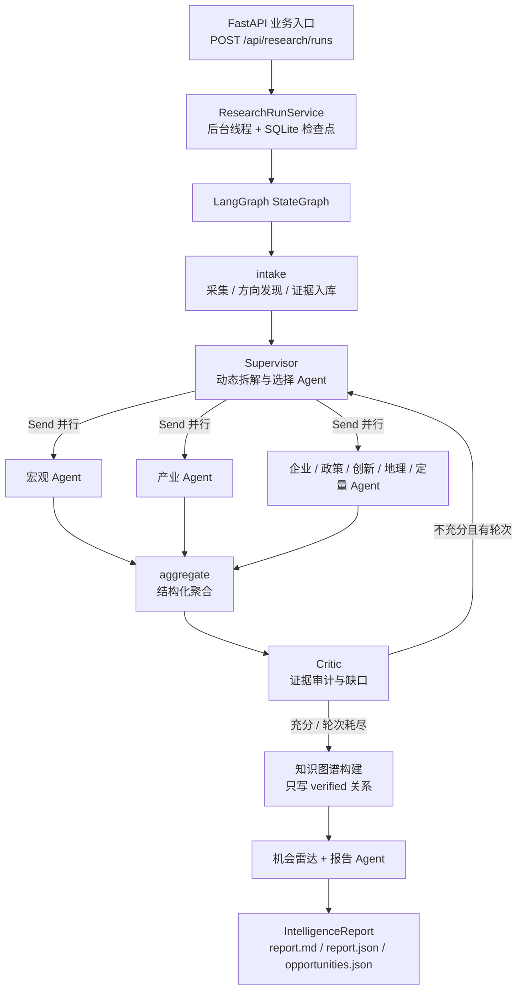

# CountyResearchAI V2 · Agentic Industrial Intelligence Platform

面向中国县域产业研究的 **多 Agent 智能研究平台**。输入一个县名与可选产业方向，平台由 Supervisor 动态拆解研究问题、并行调度多个专业 Agent、用证据约束知识图谱、审计结论可靠性，并输出可追溯的产业研究报告与补链机会。

> V2 已从「固定 Workflow + CLI 报告生成器」重构为「LangGraph 多 Agent + FastAPI 平台」。固定流程、CLI 业务入口与 `pipeline.py` 已移除。旧版迁移说明见 [MIGRATION_V2.md](MIGRATION_V2.md)，整体设计见 [ARCHITECTURE_V2.md](ARCHITECTURE_V2.md)。

## 核心能力

| 能力 | 说明 |
| :--- | :--- |
| 自主研究编排 | Supervisor 理解研究目标、动态选择专业 Agent、`Send` 并行分发；Critic 审计后决定是否补充检索 |
| 8 个专业 Agent | 宏观、产业、企业、政策、创新、地理、定量、机会；各有独立提示词、工具白名单、结构化输出 |
| 证据约束 | 每条结论绑定 Evidence ID；未知/伪造证据会被降级为 `unverified` 并记录缺口 |
| 知识图谱 | 13 类实体、13 类关系；`verified / inferred / pending / unverified` 四态；未验证关系默认拒绝入库 |
| GraphRAG | 企业关系、供应链、链路、集群、园区、政策关联、证据追溯、多跳查询 |
| Star A · 缺口雷达 | 识别缺失环节、弱本地配套、外部依赖、低区位熵，输出可解释的招商/补链机会 |
| Star B · 数字孪生 | 已定义 `SimulationEngine` 边界与确定性基线引擎；Mesa 引擎明确未校准、不伪造结果 |
| Star C · 时序智能 | 关系 `valid_from / valid_to / observed_at` 的 as-of 查询、差异比较与历史追溯接口 |
| FastAPI | 异步运行、SSE 事件流、运行恢复、报告/证据/图谱/仿真 API |

## 架构总览



专业 Agent 通过统一 Tool 层访问搜索、证据、图谱与定量服务；Agent 不能直接写图，也不能把 LLM 推测当作事实关系。

## 快速开始

需要 Python 3.10+。以下命令在 PowerShell 中运行：

```powershell
git clone https://github.com/OrdoAbChao7/CountyResearchAI.git
cd CountyResearchAI
python -m venv .venv
.\.venv\Scripts\Activate.ps1
python -m pip install -e ".[dev]"
Copy-Item .env.example .env
```

在 `.env` 中填入 `LLM_API_KEY` 与所选搜索服务的 Key。**没有 Key 也可以启动**：容器会使用 Mock LLM / Mock 搜索 / 内存图存储，适合验证架构与测试，但输出不能作为研究证据。

启动 API：

```powershell
uvicorn county_research_ai.api.main:app --reload --port 8000
```

提交一次研究：

```powershell
$body = @{ county = "安吉县"; focus = "竹产业" } | ConvertTo-Json
$run = Invoke-RestMethod -Method Post -Uri http://127.0.0.1:8000/api/research/runs -ContentType "application/json" -Body $body
Invoke-RestMethod -Uri "http://127.0.0.1:8000/api/research/runs/$($run.run_id)"
```

运行产物默认写入 `data/runs/{run_id}/`：`run.json`、`events.jsonl`、`evidence.json`、`documents.json`、`report.md`、`report.json`、`opportunities.json`。检查点位于 `data/runs/checkpoints.sqlite`。

## API

| 方法 | 路径 | 说明 |
| :--- | :--- | :--- |
| `POST` | `/api/research/runs` | 创建研究运行（202） |
| `GET` | `/api/research/runs` | 列出运行 |
| `GET` | `/api/research/runs/{run_id}` | 运行状态、计划、Agent 结果、Critic |
| `POST` | `/api/research/runs/{run_id}/resume` | 从检查点恢复 |
| `GET` | `/api/research/runs/{run_id}/events` | SSE：Agent/工具/进度/错误事件，结束发 `stream_end` |
| `GET` | `/api/research/runs/{run_id}/report` | 报告 Markdown |
| `GET` | `/api/research/agents` | 专业 Agent 能力清单 |
| `GET` | `/api/graph/{county}` | 县域子图 |
| `GET` | `/api/graph/query` | GraphRAG 自然语言查询 |
| `GET` | `/api/graph/entities/{entity_id}` | 实体详情 |
| `GET` | `/api/evidence/runs/{run_id}` | 运行证据快照 |
| `GET` | `/api/evidence/runs/{run_id}/{evidence_id}` | 单条证据追溯 |
| `GET` | `/api/reports` | 已生成报告的运行 |
| `GET` | `/api/reports/{run_id}` / `/download` | 报告 JSON / Markdown 下载 |
| `GET` | `/api/simulations/capabilities` | 仿真能力与边界 |
| `POST` | `/api/simulations` | 基线情景仿真 |
| `GET` | `/healthz` | 检查点/图/LLM/搜索后端 |

OpenAPI 文档：`http://127.0.0.1:8000/docs`。

## 配置

- `config/settings.yaml`：Agent 预算、图谱后端、API、仿真、时序、存储等非敏感配置。
- `.env`：LLM 与搜索密钥、`GRAPH_BACKEND`、Neo4j 连接、`API_*`、`AGENT_*`、`RUNS_DIR`。
- Neo4j 是可选依赖：`pip install -e ".[graph]"`，并设置 `GRAPH_BACKEND=neo4j`、`NEO4J_URI`、`NEO4J_PASSWORD`。未配置时使用 `InMemoryGraphStore`，所有测试无需真实数据库。

关键 Agent 预算（`config/settings.yaml`）：

| 配置 | 默认 | 作用 |
| :--- | :---: | :--- |
| `agents.max_steps` | 6 | 单 Agent 最大工具步数 |
| `agents.max_llm_calls` | 6 | 单 Agent 最大模型调用数 |
| `agents.max_specialists` | 6 | 单轮最多并行 Agent 数 |
| `agents.max_rounds` | 2 | Critic 反思补研最大轮数 |
| `agents.recursion_limit` | 120 | LangGraph 递归上限 |

## 项目结构

```text
src/county_research_ai/
├── api/                 # FastAPI 入口、路由、依赖、Schema
├── agents/              # 8 个专业 Agent、Critic、Report、工具与注册表
├── orchestration/       # LangGraph 图、状态、Supervisor、路由、节点、检查点、运行服务
├── knowledge_graph/     # 本体、抽取、消歧、图存储、GraphRAG、时序
├── services/            # 搜索、证据、文档、发现、图谱、定量、机会、报告
├── shining_stars/       # Star A/B/C 的领域契约与实现
├── domain/              # 共享领域模型与事件
├── infrastructure/      # 搜索适配器
├── search/              # 既有采集、消歧、深度检索
├── llm/                 # 兼容 OpenAI 的模型客户端与分析器
├── reporting/           # Markdown 模板与渲染
├── storage/             # 本地文件存储
└── bootstrap/           # 应用容器与依赖装配
```

## 测试

```powershell
python -m pytest -q --no-cov
```

测试默认使用 Mock LLM、静态搜索与内存图存储，不读取真实 Key，不依赖 Neo4j。当前测试覆盖服务、Agent、知识图谱、LangGraph 编排（含检查点恢复）、FastAPI（含 SSE）与三大 Star。详见 [docs/development/testing.md](docs/development/testing.md)。

## 边界与限制

- 公开资料覆盖度取决于地区与搜索服务；Mock 模式只能验证流程。
- 图谱只接受有证据的 `verified` 关系；`inferred` 机会与结论均显式标注，不能作为既成事实。
- Star B 当前只提供确定性会计基线，不含价格、政策反馈与行为仿真；Mesa 引擎未实现。
- Star C 提供时点查询接口；完整版本链需 Neo4j 版本节点或 Graphiti。
- 本项目是研究辅助工具，报告需人工核查后使用。

## 文档

- [ARCHITECTURE_V2.md](ARCHITECTURE_V2.md)
- [MIGRATION_V2.md](MIGRATION_V2.md)
- [系统总览](docs/architecture/system-overview.md)
- [多 Agent 设计](docs/architecture/multi-agent-design.md)
- [知识图谱设计](docs/architecture/knowledge-graph-design.md)
- [数据模型](docs/architecture/data-model.md)
- [开发环境](docs/development/setup.md) / [测试](docs/development/testing.md)
- [Shining Stars 路线图](docs/roadmap/shining-stars.md)

## 协作

欢迎提交 Issue 与 Pull Request。讨论交流请前往 [Discussions](https://github.com/OrdoAbChao7/CountyResearchAI/discussions)。
