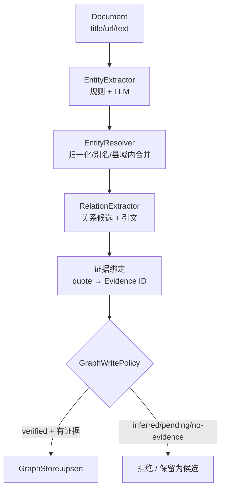

# 知识图谱设计

> 对应代码：`src/county_research_ai/knowledge_graph/`。设计原则：**没有证据的关系不是事实**。

## 1. 结构

```text
knowledge_graph/
├── ontology/
│   ├── entities.py      # 13 类实体（Pydantic 模型）
│   ├── relations.py     # 13 类关系 + 关系类型枚举
│   └── schema.py        # 约束、校验、GraphWritePolicy
├── extraction/
│   ├── entity_extractor.py     # 规则 + LLM 抽取
│   └── relation_extractor.py   # 关系抽取（必须带引文）
├── entity_resolution/resolver.py  # 名称归一化、别名、县域内合并
├── graph_store/
│   ├── base.py          # GraphStore 抽象端口
│   ├── mock_store.py    # 内存实现（默认）
│   └── neo4j_store.py   # 参数化 Cypher 适配器
├── graph_rag/
│   ├── retriever.py     # 多跳检索、供应链、聚类
│   └── query_engine.py  # 自然语言查询路由
└── temporal/models.py   # 时点/区间模型
```

## 2. 本体

### 实体（13）

| 实体 | 关键字段 | 说明 |
| :--- | :--- | :--- |
| `County` | name, province, city, code | 研究主体 |
| `Industry` | name, code, level | 产业大类/中类 |
| `IndustrySegment` | name, chain_stage, parent_industry_id | 产业链环节 |
| `Enterprise` | name, credit_code, county_id, scale, output | 企业 |
| `Product` | name, category, unit | 产品 |
| `Material` | name, category | 原材料 |
| `Technology` | name, maturity, domain | 技术 |
| `IndustrialPark` | name, level, area, county_id | 园区 |
| `Policy` | title, issuer, doc_no, effective_date | 政策 |
| `Institution` | name, type | 高校/院所/协会/平台 |
| `Patent` | title, number, applicant, filing_date | 专利 |
| `Indicator` | name, value, unit, year, source | 指标 |
| `Evidence` | evidence_id, title, url, published_at, quote | 证据节点 |

所有实体带 `entity_id`、`county_id`（可空）、`name`、`aliases`、`attributes`、`evidence_ids`、`created_at`。

### 关系（13）

`HAS_INDUSTRY`、`CONTAINS`、`BELONGS_TO`、`LOCATED_IN`、`PRODUCES`、`USES_INPUT`、`SUPPLIES_TO`、`COOPERATES_WITH`、`COMPETES_WITH`、`SUPPORTS`、`DEVELOPS`、`APPLIED_IN`、`OWNS`。

每条 `Relation`：

```python
relation_id: str
relation_type: RelationType
source_id: str
target_id: str
source_evidence_id: str | None
evidence_ids: list[str]
confidence: float          # 0..1
verification_status: VerificationStatus
valid_from / valid_to / observed_at: datetime | None
quote: str | None
attributes: dict[str, Any]
```

## 3. 证据四态与写入门禁

| 状态 | 含义 | 能否入库（默认） | 能否被 GraphRAG 返回 |
| :--- | :--- | :---: | :---: |
| `VERIFIED` | 至少一条真实证据直接支持 | ✅（必须有 `source_evidence_id` 或 `evidence_ids`） | ✅ |
| `PENDING` | 已抽取但证据待人工/二次核验 | ✅（保留待核验，不入默认查询） | ❌（需 `include_pending=True`） |
| `INFERRED` | 规则或 LLM 推断，无直接证据 | ❌（需 `allow_inferred=True`） | ❌（需 `include_inferred=True`） |
| `UNVERIFIED` | 无证据或证据 ID 无效 | ❌ | ❌ |

`GraphWritePolicy`（`graph_store/base.py`）在 `GraphStore.upsert_relation` 之前执行：

1. `VERIFIED` 且无任何 evidence ID → `GraphWriteError`。
2. `INFERRED` / `UNVERIFIED` 且未显式允许 → `GraphWriteError`。
3. `PENDING` 可入库，但默认查询不可见；只有显式 `include_pending=True` 才会返回。
4. 本体签名不符合（如企业作为 `HAS_INDUSTRY` 起点）默认只产生 warning，`OntologySchema(strict=True)` 时才拒绝。

`KnowledgeGraphBuilder` 是唯一批量写入口：它把 `AgentResult.claims` 的证据 ID 映射为关系证据，未知 ID 直接丢弃；因此 Agent 不能绕过门禁写图。

## 4. 抽取流程



- 规则抽取覆盖「位于/坐落于」「生产/制造」「为…供应/配套」「与…合作/共建」「属于…产业」等常见表述，并把命中的原句作为 `quote`。
- LLM 抽取要求返回 JSON，且每条关系必须带 `quote`；只有引文逐字出现在原文中才绑定 `source_evidence_id` 并标 `VERIFIED`，否则标 `INFERRED`（低置信且无引文的关系会被丢弃）。
- `source_evidence_id` 由调用方（运行证据库）传入，抽取器不自造证据 ID。

## 5. 实体消歧

`EntityResolver`：

1. 全半角、空白、括号、公司后缀（有限公司/股份/集团）归一化。
2. 精确名/别名命中。
3. 同县域内模糊匹配（`SequenceMatcher` 比率 ≥ 0.88），明确不同县不合并；一方县域为空时允许进入候选池；另有包含关系匹配（长度差 ≥ 2）。
4. 企业优先用统一社会信用代码；缺失时保留原名并标 `pending_review`。

## 6. 存储适配器

`GraphStore` 端口：

```python
upsert_entity(entity: KGEntity) -> KGEntity
upsert_relation(relation: KGRelation) -> KGRelation
get_entity(entity_id: str) -> KGEntity | None
find_entities(*, entity_type=None, name=None, county=None, limit=100) -> list[KGEntity]
get_relations(*, source_id=None, target_id=None, relationship_type=None,
              include_inferred=False, include_pending=False,
              include_unverified=False, as_of=None, limit=1000) -> list[KGRelation]
neighbors(entity_id, *, depth=1, relationship_types=None,
          include_inferred=False, limit=200) -> Subgraph
shortest_path(source_id, target_id, *, max_depth=6, include_inferred=False) -> list[KGRelation]
county_subgraph(county, *, industry="", limit=200) -> Subgraph
stats() -> dict[str, int]
```

- `InMemoryGraphStore`：字典 + 邻接表，`RLock`；关系 ID 幂等；`as_of` 仅在显式传入时按时点过滤（与 Neo4j 语义一致）。
- `Neo4jGraphStore`：参数化 Cypher，节点标签按实体类型，关系类型按枚举；连接失败由 `create_graph_store` 捕获并回退内存实现。
- 两种实现共享同一组契约测试（`tests/test_knowledge_graph.py`）。

## 7. GraphRAG 查询

`GraphRAGQueryEngine` 提供：

| 方法 | 用途 |
| :--- | :--- |
| `enterprise_relations(name, county="")` | 企业上下游、合作、竞争 |
| `supply_chain(industry, county="", direction="both", depth=2)` | 产业链环节与缺口 |
| `chain_paths(source, target, county="")` | 多跳链路（`shortest_path`） |
| `clusters(county, industry="")` | 产业集群/园区—企业 |
| `park_enterprises(park, county="")` | 园区企业 |
| `policy_industry_links(industry, county="")` | 政策—产业关联 |
| `evidence_trace(entity_id=..., relation_id=...)` | 关系/实体 → 证据 → 原文 |
| `multi_hop(entity, county="", depth=3)` | 通用多跳 |
| `answer(question, county="", focus="")` | 自然语言问答（图谱 + 证据回填） |

所有查询默认 `verified`；返回结果附带 `evidence_ids`、`confidence`、`verification_status`，缺失实体返回空结果而非异常。

## 8. 时序

- 关系支持 `valid_from` / `valid_to` / `observed_at`。
- `as_of` 查询：只返回在给定时点有效的关系。
- `TemporalQuery.entity_history(entity_id)`：按 `observed_at` 输出关系出现/消失序列。
- `diff(before, after)`：比较两个时点的实体/关系集合。
- 当前是「有效区间」模型，不是完整版本链；版本节点/双时态留待 Star C 下一阶段。

## 9. Neo4j 与 Graphiti

- Neo4j 是可选依赖：`pip install -e ".[graph]"`，配置 `GRAPH_BACKEND=neo4j`、`NEO4J_URI`、`NEO4J_USER`、`NEO4J_PASSWORD`。
- 未配置或连接失败：自动使用 `InMemoryGraphStore`，健康检查返回 `graph_backend`。
- Graphiti 仅预留接口（`temporal/models.py` 的版本化关系契约），当前不引入依赖、不写实现。

## 10. 已知边界

- 关系抽取召回依赖公开文本质量；企业级供应链关系通常不公开，需工商/海关/园区数据补充。
- 消歧对同名企业和简称仍有误合并风险，跨县严格不合并是保守策略。
- 内存图不持久化；生产部署应使用 Neo4j，并从 `evidence.json` 重建。
- `include_inferred=True` 仅用于探索性分析，不得进入正式报告的既成事实。
