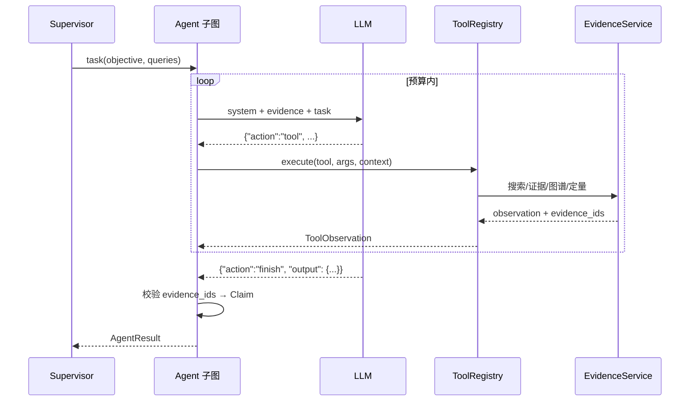

# 多 Agent 设计

> 对应代码：`agents/`、`orchestration/`。本文说明「为什么它是真 Multi-Agent」以及每个组件的职责边界。

## 1. 真自主性的判定标准

本项目中「专业 Agent」必须同时满足：

1. **独立子图**：每个 Agent 由 `build_specialist_subgraph` 编译为独立 `StateGraph`，不是普通函数改名。
2. **独立提示词与边界**：`AgentSpec.system_prompt` 明确职责、禁止越界、禁止编造。
3. **独立工具白名单**：`AgentSpec.tools` 之外的工具无法调用，越权会记录 `tool_not_allowed`。
4. **自主循环**：模型逐步输出 `{"action":"tool",...}` 或 `{"action":"finish",...}`，自行决定下一步与结束。
5. **结构化输出**：统一落到 `AgentResult`，包含 claims、evidence_ids、findings、gaps、confidence、degraded。
6. **预算与异常处理**：`max_steps` / `max_llm_calls` 限制；超限或异常时降级，不无限循环。
7. **证据约束**：claim 只能引用证据库中真实存在的 Evidence ID；伪造 ID 会被清除并标 `unverified`。

## 2. Supervisor

`orchestration/supervisor.py`：

- 输入：county、focus、research_question、objectives、round、上一轮 Agent 结果、Critic 报告与 followup queries。
- 输出：`ResearchPlan { research_question, objectives, tasks[], rationale, round, planner_source }`。
- LLM 规划：给 Agent 目录、问题树建议、上一轮摘要与 Critic 缺口；只允许 8 个专业 Agent，每个至多 1 个任务，最多 `max_specialists` 个。
- 确定性规划：首轮按问题树优先级取任务；后续轮按关键词把 followup queries 路由到对应 Agent，并记录 `parent_gap`。
- Supervisor **不执行检索、不写结论、不写报告**；它只拆解、分配、控制轮次。

## 3. 问题树

`orchestration/question_tree.py` 定义 7 个维度：产业（优先级 1）、宏观（1）、企业（2）、政策（2）、地理（3）、创新（3）、定量（4），并追加用户 objectives（优先级 0）。问题树只提供研究框架与检索模板，不产生事实。

## 4. 并行分发

`orchestration/routing.py::dispatch_specialists` 把每个任务转换为：

```python
Send(node_name, {"task": task.model_dump(mode="json")})
```

LangGraph 并行执行被 Send 的分支；每个分支是一个编译子图，输出 `results` 列表，通过 `Annotated[list, operator.add]` reducer 汇入父图。父图为每个 `agent_*` 节点显式添加 `→ aggregate` 边，保证扇入。

## 5. Agent 循环



- 解析失败会追加纠正消息并重试；预算耗尽后用已有观察构建降级结果。
- `finish` 的 output 不需要严格匹配 Pydantic 模型才能返回（容错），但字段会映射到统一结构。
- 未知证据 ID：claim 保留文本，`evidence_ids=[]`，状态 `unverified`，gaps 记录缺失 ID。

## 6. Critic 反思循环

`agents/critic/agent.py` 先做确定性审计：

- 无证据/未知证据 claim → `unsupported_claim` / `invalid_evidence_ref`（high）。
- 可信度 < 0.4 → `weak_source`。
- 降解 Agent → `degraded_agent`。
- 缺少 macro/industry/enterprise → `coverage_gap`。
- 证据冲突 → `conflict`。
- 充分条件：有结论、无 high、覆盖率 ≥ 0.7、≥ 3 个 Agent 有结论、证据 ≥ 5 条。

LLM 审计只能补充 findings；若确定性审计发现无证据结论或覆盖率 < 0.5，会强制 `is_sufficient=False`。`after_critic` 在「不充分 + 还有轮次 + 有 followup queries」时进入 supplement，否则收束到图谱构建。

## 7. 报告 Agent

`agents/report/agent.py` 只组织既有结果：

- LLM 提示词禁止引入输入之外的数字、企业或政策。
- 无 LLM 时使用确定性草稿：按 Agent 分节、列出 claims 与证据、追加机会与审计章节。
- 机会部分必须标注「分析推断」。

## 8. 添加新 Agent 的步骤

1. 在 `agents/findings.py` 增加输出模型（可选，`dict` 也可）。
2. 新建 `agents/<name>/agent.py`，定义 `SYSTEM_PROMPT`、`AgentSpec`（kind、工具、fallback_calls、fallback_builder）与 `build()`。
3. 在 `agents/registry.py` 的 `BUILDERS`/`SPECS` 注册，并在 `domain/intelligence.py::AgentKind` 增加值。
4. 在 `orchestration/question_tree.py` 增加问题分支（可选），在 `supervisor._HINTS` 增加 followup 路由关键词。
5. 图会自动添加 `agent_<kind>` 节点与汇入边；补充测试：降级、工具白名单、结构化输出、Critic 覆盖。
