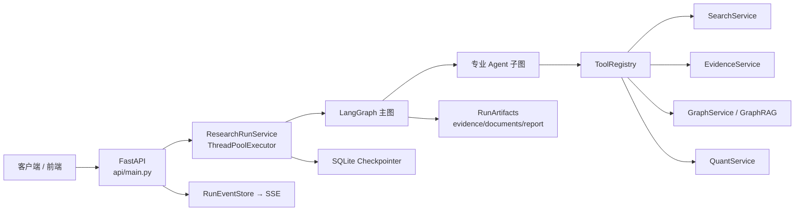

# 系统总览

> 对应代码：`src/county_research_ai/{api,bootstrap,orchestration,agents,services,knowledge_graph,shining_stars}`。

## 1. 运行拓扑

一次运行的生命周期：

1. `POST /api/research/runs` 校验请求并创建 `ResearchRunRecord`，写入 `run.json`，提交后台任务，返回 202。
2. 后台线程构造运行级 `EvidenceService`、`AgentContext`、`RunArtifacts`、`RunEventStore`，调用 LangGraph。
3. 图节点通过 `RunnableConfig.configurable` 读取服务与上下文；状态只保存 JSON。
4. 每次 Agent/工具/节点动作写入 `events.jsonl`；SSE 从事件存储增量读取。
5. 完成后 `record` 写入状态、计划、Agent 结果、Critic、机会与报告路径。
6. `POST /api/research/runs/{run_id}/resume` 可从 SQLite 检查点继续；证据/文档从运行目录重建。

## 2. 分层与依赖

| 层 | 目录 | 允许依赖 |
| :--- | :--- | :--- |
| 入口 | `api/` | orchestration、services、agents（仅目录清单） |
| 组合根 | `bootstrap/` | services、orchestration、shining_stars、storage、llm |
| 编排 | `orchestration/` | agents、services、knowledge_graph、domain |
| Agent | `agents/` | services、knowledge_graph、domain、llm |
| 能力 | `services/` | knowledge_graph、domain、search、llm、storage |
| 图谱 | `knowledge_graph/` | domain |
| 领域 | `domain/` | 无上层依赖 |

`tests/test_architecture_imports.py` 会检查：domain 无外向依赖；agents 不依赖 orchestration/api；knowledge_graph 不依赖 agents/orchestration/api；services 不依赖 agents/api/orchestration；旧模块不存在。

## 3. 并发模型

- API 进程内使用 `ThreadPoolExecutor(max_workers=settings.api.max_concurrent_runs)`。
- LangGraph 的 `Send` 让同一轮专业 Agent 并行执行；每个 Agent 子图只写自己的 `AgentResult`，通过 reducer 合并。
- `EvidenceService` 内部 `RLock`，支持并行 Agent 同时检索/写入。
- `ThreadLocalEvidenceLookup` 让共享的 GraphRAG 引擎按线程绑定当前运行的证据库，避免跨运行污染。
- 当前检查点是 SQLite 单文件，适合单进程多线程；多副本部署需替换为共享检查点后端。

## 4. 持久化

| 文件 | 内容 |
| :--- | :--- |
| `{runs_dir}/{run_id}/run.json` | `ResearchRunRecord` 快照 |
| `events.jsonl` | 追加式事件（seq 单调递增） |
| `evidence.json` | `EvidenceService` 快照 |
| `documents.json` | 原始资料快照 |
| `report.md` / `report.json` | 平台报告 |
| `opportunities.json` | 机会候选 |
| `{runs_dir}/checkpoints.sqlite` | LangGraph 检查点（thread_id = run_id） |

## 5. 降级矩阵

| 外部依赖 | 缺失时 | 影响 |
| :--- | :--- | :--- |
| LLM API | `MockLLMClient` 或 `None` | Agent 走确定性工具序列，`degraded=True` |
| 搜索 API | Mock/静态 provider | 资料与证据减少，事件标 `notice` |
| Neo4j | `InMemoryGraphStore` | 图只在进程内，重启后需从证据重建 |
| SQLite | `InMemorySaver` | 无法跨进程恢复 |
| Mesa | `SimulationEngineUnavailable` | Star B 只提供基线会计外推 |

## 6. 扩展点

- **新增专业 Agent**：在 `agents/<name>/agent.py` 定义 `SPEC` 与 `build`，注册到 `agents/registry.py`，`orchestration/graph.py` 自动添加子图节点与汇入边。
- **新增工具**：在 `agents/tools.py` 实现 handler 并加入 `build_default_tools`，再在 Agent `SPEC.tools` 中授权。
- **新增图存储**：实现 `GraphStore` 抽象（`graph_store/base.py`），在 `bootstrap/container.py` 的 `create_graph_store` 注册。
- **新增仿真引擎**：实现 `shining_stars/digital_twin/models.py` 的 `SimulationEngine` 协议，在 `DigitalTwinService` 注册。
- **新增 API**：在 `api/routes/` 新建 router，并在 `api/main.py` 与 `api/routes/__init__.py` 注册。
