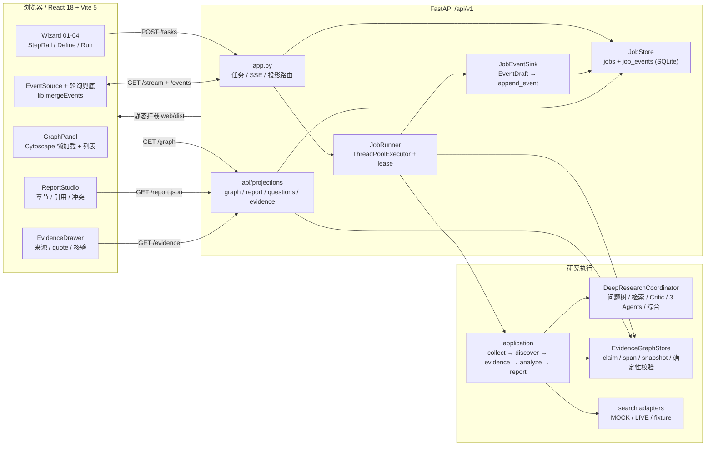
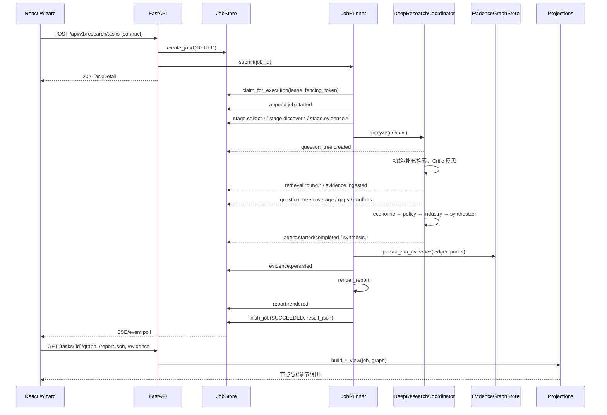

# AxiomScope 架构走读（面试版）

本文按 10 个知识点讲解当前 `codex/finish-roadmap` 的真实实现。所有结论都对应当前
仓库代码；先给路径与行号，再解释取舍。产品默认 `MOCK`，检索/LLM 结论不代表真实
研究质量。

## 1. 系统总体架构



关键分层：

| 层 | 代码 | 职责 |
| --- | --- | --- |
| 契约/领域 | `domain/research_contracts.py` | `ResearchContract`、`AtomicClaim`、阈值、预算 |
| 研究执行 | `application/`、`research_agent/` | 采集、问题树、检索、Agent、综合、报告 |
| 证据 | `evidence/` | 快照、span、ledger、SQLite 证据图、确定性校验 |
| 持久化任务 | `api/jobs.py` | `jobs` / `job_events`、lease、fencing、恢复 |
| 观察 | `observability/`、`api/event_sink.py` | ContextVar 事件总线 → 现有事件表 |
| 投影 | `api/projections/` | 只读图谱/报告/问题/证据视图 |
| 前端 | `web/src/` | Wizard、时间线、图谱、报告、证据抽屉 |

没有第二套 RunManager、任务队列、JSONL 存储或 `/api/v1/runs` 并行 API；SSE 和
SQLite 事件表仍是唯一运行事件基础设施。

## 2. 一次研究任务的完整时序



前端 `App.tsx:76` 每 1.5 秒轮询任务与事件，`App.tsx:117` 同时用 `EventSource`
订阅全部事件类型；`lib.ts:162` 的 `mergeEvents` 按 `seq` 去重排序，所以 SSE
断线或重复投递不会造成重复/乱序。任务终态后轮询继续保留，作为恢复兜底。

租约/取消/截止时间仍由 `worker.py:98` 的执行流程控制，深度研究只是在
`analyze` 阶段内部运行，没有另建状态机。

## 3. 多 Agent 调度机制

入口是 `DeepResearchCoordinator.run_deep_research`
（`research_agent/coordinator.py:119`）：

1. `build_question_tree` 按模式生成问题树（`research_agent/tree.py:13`），
   发出 `question_tree.created`（`coordinator.py:134`）。
2. 有 `collect_adaptive` 时使用 `AdaptiveRetrievalController`，按轮检索；
   每轮发出 `retrieval.round.started/completed`（`coordinator.py:160`、
   `211`、`323`）。
3. `ResearchCritic.reflect` 检查证据是否足够、输出 gaps 和补充查询
   （`research_agent/critic.py:44`），对应 `reflection.*`。
4. 证据入库后评估问题覆盖率、合并 gaps、读取冲突，发出
   `question_tree.coverage` / `gaps.detected` / `conflicts.detected`
   （`coordinator.py:360-383`）。
5. 按模式调度专业 Agent：
   - snapshot：`EconomicResearchAgent` → `PolicyResearchAgent` →
     `IndustryResearchAgent`（`research_agent/specialized/*.py`），顺序执行，
     每个都有 `agent.started/completed`（`coordinator.py:472` 起）。
   - rise-fall / long-history：各自 analyzer，也发 `agent.started/completed`。
6. `ResearchSynthesizer.synthesize` 汇总三个分项，`synthesis.started/completed`
   （`coordinator.py:528`），再生成执行摘要。

这是一个“协调器 + 专业分工”的结构，不是大规模 Agent 群：Agent 数量固定、顺序
执行、输入来自同一证据库、没有自主工具循环。`max_turns` 限制反思/补充检索轮次，
避免无限循环。旧 CLI 的 `agent/` Plan-and-Execute 仍在，但不参与 API 的深度研究
主路径，二者没有互相替换。

面试可追问：为什么不让 Agent 自由并发？因为共享 `EvidenceStore` 和问题树一致
性比并发收益重要，顺序执行也让事件顺序和失败定位可解释；真正的并发检索发生在
`collect_adaptive` 内部，而不是 Agent 层。

## 4. 搜索与证据数据流

```text
RawDoc (title/url/content/snippet/domain/credibility)
  → DocumentProcessor.process
  → EvidenceChunk / AtomicClaim
  → EvidenceLedger.select_evidence_pack(question_slot)
  → EvidencePack (selected claims + source map + reasons/gaps)
  → persist_run_evidence(graph, ledger, packs, run_id, contract)
  → SourceSnapshot → EvidenceSpan → Claim → Entity/Relation → Finding
```

- 搜索适配器在 `search/`；MOCK 适配器是 `mocks/search.py`，API 在
  `live_enabled=false` 时强制 MOCK（`api/worker.py:49`）。
- 自适应检索按问题槽生成查询，受 `RetrievalBudget` 限制
  （`coordinator.py:155`）。
- `EvidenceLedger` 负责按证据包选择 claim；`application` 的
  `build_evidence` 阶段产出 ledger/packs。
- `persist_run_evidence`（`api/evidence_service.py`）把 ledger 写入
  `EvidenceGraphStore`，并计算独立来源/支持结论等阈值摘要。
- 校验时每个 claim 的链是 `snapshot → span → edge → claim → finding`；span
  保存精确 quote、偏移和哈希，snapshot 保存内容哈希。`evidence/graph.py:278`
  的 `_claim_supported_by_quote` 要求同一个 span 同时包含地区、期间、数值/单位
  和 statement/metric，不能把不同 span 的片段拼成支持。

独立来源按 canonical URL 与规范化内容分组（`evidence/source_identity.py:14`），
转载不会放大支持数；`supporting_sources` 只返回真正通过 span 完整性 + 本地绑定
的链接（`evidence/graph.py:1306`）。

## 5. SQLite JobStore 与 Worker

`api/jobs.py:105` 建立两张表：

```sql
jobs(job_id PK, status, contract_json, result_json, report_path,
     lease_owner, lease_expires_at, fencing_token, ...)
job_events(job_id, seq, event_type, payload_json, created_at,
           PRIMARY KEY(job_id, seq))
```

状态：`QUEUED / RUNNING / SUCCEEDED / FAILED / CANCELLED /
BUDGET_EXHAUSTED / INTERRUPTED`。执行流程（`api/worker.py:98`）：

1. 读取 job；终态直接返回。
2. `claim_for_execution` 原子地把 job 置为 RUNNING、写 lease owner/过期时间，
   `fencing_token += 1`（`jobs.py:242`）。
3. 心跳线程定期 `renew_lease`（`worker.py:271`）；terminal 写入要求
   owner + fencing token 匹配，陈旧 worker 的结果会被拒绝。
4. `push_event_sink(JobEventSink(...))` 在 worker 线程内绑定事件 sink
   （`worker.py:122`），因为 ContextVar 不跨线程。
5. 顺序执行 collect/discover/evidence/analyze/report；阶段之间检查取消、
   deadline 和 lease。
6. `finish_job` 更新终态、结果和 `report_path`；WHERE 条件包含
   `status NOT IN (terminal)`（`jobs.py:364`），重复完成不会追加第二条
   `job.completed`。
7. 启动时 `recover_interrupted` 只处理 RUNNING 且 lease 为空/过期的任务；
   有活 lease 的任务不动，因此多个 API 进程可共享同一 job 数据库。

事件追加在 store lock 下取 `MAX(seq)+1` 并插入（`jobs.py:534`），保证同一
job 的序号唯一连续；测试覆盖 40 并发 append。仍是单机 SQLite，不是分布式
调度器；`max_workers=1` 是默认值。

## 6. SSE 事件机制

- 事件模型：`observability/events.py:14` 的 `EventDraft(type, stage, level,
  message, payload)`。
- 事件总线：`ContextVar[EventSink|None]`（`events.py:37`）。`emit()` 在未绑定
  或 sink 抛错时静默返回（`events.py:72`），观察失败不能中断研究。
- 适配器：`api/event_sink.py:19` 把 draft 扁平化为 JSON-safe payload，调用
  `JobStore.append_event`；payload 自动带 `level/stage/message`。
- 查询：`GET /tasks/{id}/events?after=` 返回 `seq > after` 的事件
  （`api/app.py:221`）。
- 流：`GET /tasks/{id}/stream`（`api/app.py:232`）支持 `Last-Event-ID`，
  `_event_stream` 每 200ms 查新事件，写出 `id: seq` / `event: type` /
  `data: json`，终态且无新事件后关闭（`app.py:250`）。
- 前端：`EventSource` 监听 `EVENT_TYPES`（`web/src/lib.ts:11`），
  `mergeEvents` 去重；SSE 出错关闭后，1.5s 轮询继续提供恢复能力。

真实事件类型：

```text
job.queued / job.started / job.resumed / job.cancel_requested
stage.{collect,discover,evidence,analyze,report}.started/completed
question_tree.created / question_tree.coverage
retrieval.round.started / retrieval.round.completed
evidence.ingested / evidence.persisted
reflection.started / reflection.completed
gaps.detected / conflicts.detected
agent.started / agent.completed
synthesis.started / synthesis.completed
report.rendered / job.completed
job.cancelled / budget.exhausted / job.failed / job.interrupted
```

没有章节级流式生成事件，没有固定 token 消耗事件，也没有未执行工具调用的伪事件。

## 7. 知识图谱构建与可视化

**后端投影**（`api/projections/graph.py:33`）只读已持久化数据，节点类型：

| 节点 | 来源 | 主要边 |
| --- | --- | --- |
| `county` | contract/regions | `has_question` |
| `question` | deep research question tree | `supported_by`（仅映射到持久化证据项） |
| `evidence` | `EvidenceGraphStore.list_findings` | `cited_from`、`belongs_to` |
| `source` | snapshot canonical URL | `cited_from` |
| `topic` | claim metric | `belongs_to` |
| `gap` | deep research gaps | `has_gap` |
| `conflict` | deep research conflicts | `conflicts_with`（至少两条证据匹配） |

稳定性与真实性：

- 节点/边 ID 由内容/身份哈希生成；同一 run 重复请求顺序稳定。
- URL 先规范化（scheme/host 小写、去 fragment/追踪参数，见
  `api/projections/common.py`），同一来源合并，`snapshot_ids` 保留全部快照。
- 平行边加 `:p2`、`:p3` 后缀，避免 Cytoscape 丢边；自环丢弃并计数。
- 冲突只在 claim URL 能匹配到已持久化证据时连边；匹配不足两条时冲突节点仍
  显示 `unmatched_claims`，但不生成假边（`graph.py:362` 附近）。
- 默认 400 节点 / 800 边；问题、缺口、冲突等 required 节点优先保留，截断时
  先连同 topic/source 邻居一起选，剩余容量再补连通节点（`graph.py:412`、
  `454`），避免“400 个孤立证据点、0 条边”。

**前端**：`web/src/components/GraphPanel.tsx:37` 取 `/graph`，本地做类型/搜索/
主题/来源筛选；`GraphCanvas` 通过 `React.lazy` 单独加载（构建产物约 455 kB），
使用 Cytoscape 内置 `cose` 布局（`GraphCanvas.tsx:228`）。点击节点/边只更新
选中态和 focus class，不重建图（`GraphCanvas.tsx:250`）；背景点击保留当前选择。
节点类型用颜色+形状双重区分，冲突边有独立虚线样式。列表页签
（`GraphPanel.tsx:317` 起）是无障碍替代视图；在列表打开证据同样进入证据抽屉。

没有证据支持的供应商/客户/原材料关系不会生成；图谱是证据关系图，不是产业
链推断图。

## 8. 三个 P0 事实可信度机制

### P0-1 冲突数值不能继续授权 VERIFIED

- `EvidenceStore` 按指标、期间、口径等分组，发现可比数值差异时把相关项标为
  `conflicting`；`_apply_conflict_status` 保存原始状态，重复摄入会重算而不是
  清除未决冲突（`evidence/store.py:406`）。
- 确定性 verifier 在“自身有支持、同时存在有支持的相反 claim”时返回
  `NEEDS_REVIEW`（`evidence/graph.py:1344`），不会返回 `SUPPORTED`。
- `numeric_context_matches` 要求数值、方向、期间、范围/口径出现在同一局部
  语境（`evidence/numeric_support.py:53`）；`infer_period` 排除发布日期
  （`evidence/measure.py:96`）。
- 回归：`tests/test_evidence_store.py::test_repeated_imports_keep_conflicting_items_out_of_verified_state`、
  `tests/test_evidence_graph.py::test_two_supported_conflicting_claims_need_review`、
  `tests/test_reliability_hardening.py`。

### P0-2 实体必须绑定准确证据

- 企业名抽取保留原文子句，不合成“龙头骨干企业: X”这类事实；否定/疑似语境
  （“不存在”“疑似冒名”）直接跳过（`evidence/store.py:184`）。
- 实体证据仍要经过统一 claim/span 校验；文档级关键词不能认证不存在的企业。
- 回归：`tests/test_evidence_store.py::test_enterprise_evidence_is_the_source_clause_not_a_synthesized_fact`、
  `::test_negated_or_uncertain_enterprise_mentions_are_not_extracted`。

### P0-3 报告不能修改已核验事实

- `build_report_view` 只把 `VerificationStatus.SUPPORTED` 的 finding 放进
  “已核实事实”表（`api/projections/report.py:48`）；其余进入冲突/不可比/
  缺口章节。
- 表格数值、单位、期间、范围、口径直接来自持久化 claim，不由 LLM 重新生成；
  引用只来自同一 finding chain，因此不能用一个合法 Evidence ID 给无关数字
  背书。
- Markdown 生成对来源/statement/冲突文本做 HTML 转义与表格管道转义
  （`report.py:453`），引用链接只允许有 host 的 `http(s)`（`report.py:467`）。
- 回归：`tests/test_report_projection.py::test_verified_report_uses_only_supported_facts`、
  `::test_report_escapes_malicious_source_text_without_dropping_facts`，
  以及 `tests/test_projection_api.py` 的路径穿越测试。

## 9. 报告生成与引用

`build_report_view`（`api/projections/report.py:36`）生成固定六节：

1. 研究结论摘要（合同、运行结果、覆盖率、结构化结论计数）。
2. 已核实事实（仅 `SUPPORTED`，表格：引用编号/指标/数值/期间/结论/原文/来源）。
3. 冲突、反证与不可比（真实 conflict + 非支持状态 claims）。
4. 证据缺口（deep research gaps）。
5. 来源快照（run 内 snapshot）。
6. 方法与限制（模式、校验版本、边界）。

引用：

- `build_citations(findings)` 生成 claim → source 的引用视图；
  `citation_numbers` 按真实证据去重编号。
- 章节的 `citation_ids` 与证据抽屉共用同一 claim/snapshot ID；前端
  `ReportStudio.tsx` 渲染角标，点击后 `EvidenceDrawer` 用 claim 定位并高亮
  精确 quote。
- 来源无法匹配时不强行编号，避免“有编号无来源”。

Provenance：

- snapshot 模式保留原生 `native_sections`（worker `_report_projection`，
  `api/worker.py:391`）。
- rise-fall / long-history 从 Markdown 二级标题拆分，标注
  `markdown_split`；旧版叙述在 UI 中明确标为背景材料，不进入事实表。
- 报告是程序根据结构化事实生成；旧版 Markdown 只作为 narrative 视图。

## 10. 关键架构决策与取舍

| 决策 | 原因 | 代价/边界 |
| --- | --- | --- |
| FastAPI + Pydantic | 契约校验、OpenAPI、与现有 Python 研究层同进程 | 单进程 API，不是微服务 |
| SQLite `jobs`/`job_events` | 单机零运维、事务简单、事件序号天然串行 | 不适合多机高并发；不是分布式队列 |
| ThreadPoolExecutor + lease/fencing | 复用现有 Runner，支持取消/恢复/崩溃接管 | 进程内执行，API 重启会中断在途任务 |
| SSE 而非 WebSocket | 单向事件、浏览器原生 `EventSource`、易回放 | 需要轮询兜底；没有双向控制通道 |
| ContextVar 事件 sink | 研究层不依赖 API/JobStore，未绑定时自动 no-op | 不跨线程，必须在 worker 线程绑定 |
| 只读 projections | 不把 EvidenceStore 直接序列化给前端；API schema 稳定 | 每次请求重建视图，超大 run 有截断 |
| Cytoscape.js + 懒加载 | 成熟图交互、cose 内置布局、按需加载 | 455 kB chunk；大图仍需截断/列表视图 |
| React 18 + Vite 5 原地升级 | 保留现有 `web/`，不重建 `frontend/` | 没有引入 React 19/新状态框架 |
| 不引入 LangGraph | 现有协调器已能表达问题树/检索/Critic/专家 Agent | 没有通用图执行引擎；复杂分支需手写 |
| 默认 MOCK、显式 LIVE | 防止误触发付费调用，E2E 可重复 | MOCK 结果不代表真实检索/模型质量 |

明确的“未做”：

- 没有章节级流式生成，也没有真实 token 计量；UI 只做完成后逐节展示。
- 没有 40–60 独立 sealed 任务集、Live 研究评测、语义 Judge、人工标注；
  这些不计入本次代码验收。
- 没有真实产业链供需关系推断；图谱只表达已持久化证据关系。
- 400 节点性能只有投影层测试，没有真实浏览器大图基准。

## 面试官可能追问的 10 个点

1. 为什么事件用 SQLite `seq` 而不是时间戳排序？——时间戳会重复/回拨，`seq`
   在 store lock 下单调分配，SSE 的 `Last-Event-ID` 可直接续传。
2. 两个 worker 同时完成同一任务会怎样？——`finish_job` 的 owner + fencing
   token + `status NOT IN terminal` 使第二个写失败，不追加事件。
3. 为什么 ContextVar 要在 worker 线程绑定？——线程池不会自动传播上下文；
   在请求线程绑定会让研究层事件静默丢失。
4. 图谱为什么需要稳定 ID？——前端增量更新、选中态、URL 分享和测试都需要
   跨请求一致；随机 ID 会导致重绘和无法定位。
5. 冲突节点为什么可能没有边？——只有至少两条 claim URL 能匹配持久化证据时
   才连 `conflicts_with`；否则保留 `unmatched_claims`，不伪造关系。
6. 截断为什么不是简单取前 400 个？——会留下大量孤立证据点；实现优先保留
   问题/冲突/缺口，并连同邻居选入，保证返回图可读。
7. 报告如何防止 LLM 改数？——事实表由结构化 claim 程序化渲染，LLM 叙述只
   作为旧版 narrative；引用来自同一 finding chain，来源文本做 HTML 转义。
8. `NOT_COMPARABLE` 与 `INSUFFICIENT` 的区别？——前者是期间/范围/口径不可比
   （如 2027 对 2024 窗口），后者是证据不足；两者都不会进入已核实事实。
9. 独立来源为什么要按 URL/内容分组？——转载会制造虚假“多源支持”；
   分组后独立支持数才可信。
10. 为什么没有直接上 LangGraph/Neo4j/Redis？——当前规模是单机研究任务，
    SQLite + 线程池 + 显式协调器已能解释和验证；引入分布式图/队列会增加
    运维与调试成本，收益未被数据证明。

## 代码索引

- API 路由：`src/county_research_ai/api/app.py:153`、`:333`
- 任务存储/租约/事件：`src/county_research_ai/api/jobs.py:105`、`:242`、`:364`、`:534`
- Worker：`src/county_research_ai/api/worker.py:98`、`:122`、`:359`、`:391`
- 事件总线/适配器：`src/county_research_ai/observability/events.py`、
  `src/county_research_ai/api/event_sink.py`
- 深度研究协调：`src/county_research_ai/research_agent/coordinator.py:119`
- 问题树/Critic/专家：`research_agent/tree.py`、`critic.py`、`specialized/`
- 证据与校验：`src/county_research_ai/evidence/graph.py:278`、`:1316`、
  `store.py:109`、`:406`、`numeric_support.py`、`source_identity.py`
- 投影：`src/county_research_ai/api/projections/{graph,report,questions,evidence}.py`
- 前端：`web/src/App.tsx:34`、`components/GraphPanel.tsx:37`、
  `components/GraphCanvas.tsx:183`、`components/ReportStudio.tsx:17`、
  `components/EvidenceDrawer.tsx:30`、`lib.ts:60`、`:162`
- E2E：`web/tests/e2e/workspace.spec.ts`、`web/playwright.config.ts`
